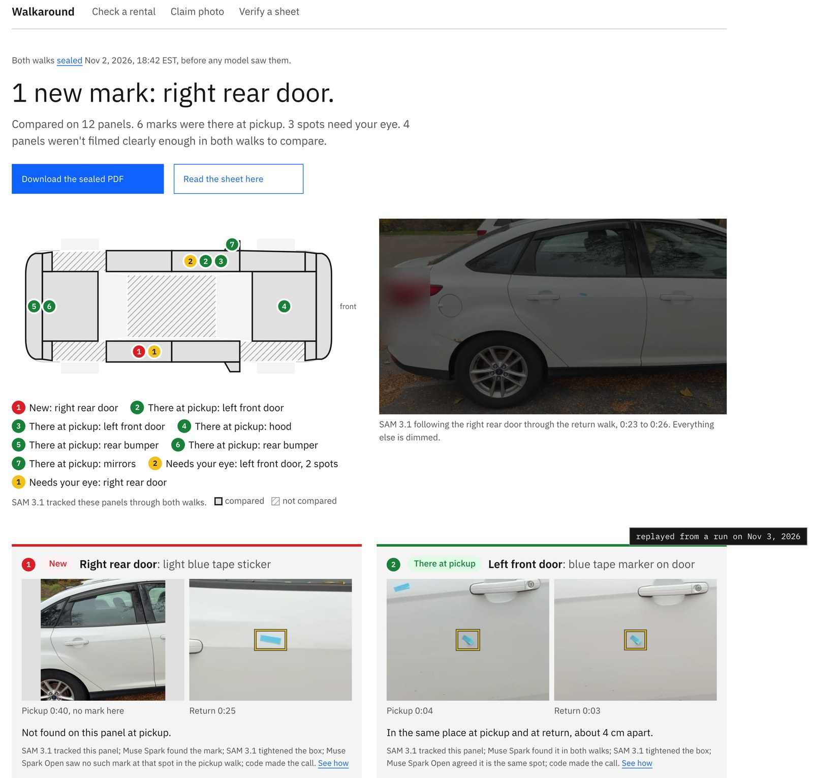

# Walkaround

Rental companies now check returned cars with AI scanners and can bill a renter for damage within minutes
([The Drive](https://www.thedrive.com/news/this-is-what-happens-when-hertzs-ai-scanner-finds-damage-on-your-rental)),
while the renter's only record is a phone video nobody can search.
Walkaround reads the renter's own pickup and return videos, finds the same spot on the same panel in both, and writes a
sealed sheet that says what was already there at pickup, what is new, and what it could not check.



- Replay this run in a browser, no install and no key:
  https://walkaround-web-production.up.railway.app/run/hero_focus5d
- 3-minute demo video: DEMO_VIDEO_LINK
- Built Oct 26 to Nov 4, 2026 by Sanat Gupta for the Meta Global AI Developer Hackathon (Indie Developer track). It is
  evidence support, not legal advice.

The picture is a friend's white Ford Focus, filmed with the owner's permission: a 52.9 s pickup walk and a 34.3 s
return walk, shot 4 minutes apart. We put blue tape strips on as stand-in marks, took one off and added one between the
walks; one scrape on the front left door is real. Walkaround got 5 of the 6 marks right, called the added strip new,
and sent the one it missed to "needs your eye" instead of giving it a wrong label
([docs/evidence/hero_focus5d_truth.md](docs/evidence/hero_focus5d_truth.md)).

## How it works

1. **Seal both walks.** Film one slow lap of the car at pickup and one at return. The phone hashes each video while it
   uploads, and the server timestamps it (RFC 3161, plus OpenTimestamps) before any model sees it.
2. **Read each walk with Meta's models.** SAM 3.1 tracks 16 car parts through each handheld video, so code knows which
   of 21 panels is on screen when, which panels were never filmed, and where plates and faces are (they are blurred
   before anything else leaves). Muse Spark 1.3 boxes marks on one blurred panel crop at a time.
3. **Decide in code.** Code gives each panel its own coordinates, taken from the center and spread of SAM's outline,
   so a spot on a door has nearly the same coordinates in both walks. It matches marks across the walks and writes
   every label with the rule that decided it. Muse Spark Open, an open-weights model on Baseten, takes a second look at
   close calls and can only lower a label to "needs your eye". The sheet shows both frames for every call and lists
   what was not compared and why.

## Proof

### The hero run, mark by mark

The run is `hero_focus5d`, the first sample in `samples/`. Its labels were recomputed on Nov 3 with the current rules
(`walkaround rederive`) from the model answers that the live run `hero_focus5` stored on Nov 2, 6:42 to 6:55 PM EST,
for $6.52. No new model calls, and `walkaround verify hero_focus5d` prints "rebuild identical". From
[docs/evidence/hero_focus5d_truth.md](docs/evidence/hero_focus5d_truth.md):

| Mark | Right label | Walkaround said | Score |
|---|---|---|---|
| rear bumper, strip A | already there | already there | right |
| rear bumper, strip B | already there | already there | right |
| front left door, strip kept | already there | already there | right |
| front left door, strip removed | not seen at return | needs your eye | miss, safe |
| right rear door, strip added | new since pickup | new | right |
| front left door, real scrape | already there | already there on its short piece; the long piece is not joined | right, in part |

5 of 6 right, no false "new" and no false "not seen at return". The whole sheet has 14 rows: 6 already there, 1 new,
3 needs your eye and 4 panels not comparable (`samples/hero_focus5d/derived/verdicts.json`). Glass and wheels get a
"check by eye" line instead of a label.

Box by box: I labelled every crop of an earlier run of the same two videos by hand
(`eval/box_corrections/hero_focus1.json`). On the 49 crops both runs share, the hand labels hold 53 real marks and Muse
Spark boxed 17 of them. 13 of its 78 boxes sat on spots I labelled not a mark (rear window glass 6, windshield 2, wheel 2,
mirror 2, roof 1), and none of those 13 became an already there, new or not seen line (same evidence file).

### My checks of the labels

I went through the labels of four runs on a review page (`tools/boxfix`, Verdicts tab) that shows the pickup and return
frames side by side, and marked each label right, wrong or can't tell. Counts from `eval/verdict_checks/summary.json`:

| Walkaround said | Labels | Checked | Right | Wrong | Can't tell |
|---|---|---|---|---|---|
| already there | 13 | 9 | 9 | 0 | 0 |
| new since pickup | 2 | 2 | 2 | 0 | 0 |
| needs your eye | 37 | 16 | 2 | 13 | 1 |
| not comparable | 43 | 17 | 1 | 8 | 8 |
| all | 95 | 44 | 14 | 21 | 9 |

Every confident label I checked was right: 9 of 9 "already there" and 2 of 2 "new". None was a false "new". All 21 wrong
labels are on the careful side, a "needs your eye" or "not comparable" where I could see the answer: 14 should have been
already there, 1 new, 1 not seen at return, and for 5 I did not pick a label.

The runs: hero_focus4 (12 of 26 labels checked) and hero_focus5b (17 of 17) are two runs of the same Ford Focus videos;
lexi_pair2 (12 of 22) is a second car, filmed on Nov 2 with its owner's permission, with paper stand-in marks;
pairC_core3 (3 of 30) is a uCO3D dataset car. These are my own checks, not an outside review, and I changed rules after
making them (`docs/CONTRACTS.md`, "R29"), so they are not a held-out test.

### Eval on licensed footage

Each pair stands alone; nothing is pooled. The panel labels are mine, from the frames, and not reviewed by anyone else.
These runs have no mark labels, so there is no precision or recall. From `eval/results.json`, except the pair C row,
which comes from `samples/pairC_core3/derived/verdicts.json` and `docs/evidence/ledger_rows.jsonl`:

| Pair | Changed between walks | Run | Labels | What it shows | Coverage right | Cost |
|---|---|---|---|---|---|---|
| NHTSA crash test 15759, before and after a side impact | left front and left rear doors | eval_nhtsa15759_r6 | 1 new, 5 needs your eye, 11 not comparable | The crushed front door is new; the struck rear door is "needs your eye" (outline changed in place). Changed panels called new: 1 of 2. Panel calls right: 4 of 4 | 22 of 35 | $3.48 |
| Pexels 4228872 and 4281322, two takes of a parked car | nothing | eval_px_two_takes_r7 | 3 needs your eye, 9 not comparable | False "new": 0 of 3 return marks | 23 of 34 | $1.70 |
| Pexels 4228872 split at 29 s | nothing | eval_px4228872_front | 9 not comparable | 1 panel compared, no marks on it | 8 of 12 | $1.74 |
| Pexels 4228872 split at its scene cut | nothing | eval_px4228872_cut | 16 not comparable | The two halves barely overlap, so nothing was compared | 14 of 26 | $2.53 |
| uCO3D pair C, one dataset car filmed twice | nothing | pairC_core3 | 1 already there, 11 needs your eye, 18 not comparable | No false "new" | not scored | $3.31 |

On the pairs where nothing changed, Walkaround mostly declines instead of guessing. Most "not comparable" panels are
ones that one of the walks did not film well enough (gate G1 in `eval/results.json`).

## How each Meta model is used

The numbers are the hero run's ledger rows, `docs/evidence/ledger_rows_hero_focus5.jsonl`: 504 calls, $6.52 in all
(Meta Model API $6.44, Baseten $0.08). Every Model API call is sent in Standard mode with storage off, and uploaded
videos are set to expire after an hour and are deleted when the run ends.

**SAM 3.1** (`sam-3.1`, Meta Model API, Responses API, streamed)
- What it does: 16 text-prompted video lanes per walk (car, license plate, face, car door, bumper, wheel, hood, trunk
  lid, fender, roof, headlight, tail light, side mirror, windshield, rear window, car window) on a 960 px, 15 fps proxy.
  Code votes the tracks into 21 panels with side and position, lists each panel as filmed, glimpsed or not filmed, and
  blurs plates and faces inside their own masks. On images, SAM 3.1 checks every keyframe for plates and faces before
  any crop leaves, and a box prompt tightens each Muse Spark box onto its mark. Stays Put follows each mark through a
  short clip along with its neighbours.
- Hero run: 32 video lanes (794 and 515 frames), $4.19, median 28.4 s a lane; 27 Stays Put clips, $0.49; 194 plate and
  face checks, $0.49; 41 box tightenings, $0.10.
- Why it matters: one noun phrase returns every door or bumper with a stable id and a mask on every frame of a shaky
  phone walk. That is how the check knows which panel is on screen when and which panels were never filmed, without
  training a car-part model.

**Muse Spark 1.3** (`muse-spark-1.3`, Meta Model API, JSON schema)
- What it does: boxes marks on one blurred panel crop per call. Each box is in the 0 to 1000 grid with a type (scratch,
  scuff, chip, dent, crack, dirt, reflection, unsure) and a size, and the crop gets flags for a wet, dirty or glare view.
  It also names the panel in a claim photo. It never sees both walks and never writes a label.
- Hero run: 188 calls, $1.17, median 9.4 s.
- Why it matters: a grounded box gives code coordinates it can carry into the panel's own frame and match across two
  walks, instead of asking a model to compare two photos and taking its word.

**Muse Voice Transcribe** (`muse-voice-transcribe-1.0`, ENDPOINTING mode)
- What it does: turns the renter's narration into timed turns. Code pins a turn that names a panel ("trunk lid, two
  small chips") to the seconds SAM shows that panel and cuts an audio clip for the sheet.
- Hero run: 2 calls on 52.96 s and 34.32 s of audio, $0.0043. It returned 1 turn at pickup and none at return, and no
  turn was pinned (`samples/hero_focus5d/derived/narration.json`). The narrated case is the uCO3D sample, where every
  turn that named a panel landed inside that panel's SAM window (`docs/evidence/D1_MEMO.md`).
- Why it matters: turn times are what let a spoken note attach to a panel and a moment in the video.

**Muse Spark Open** (`meta-models/muse-spark-open-1026`, Baseten Model APIs, open weights)
- What it does: the second look. It sees two outlined crops. For a pair already inside the "already there" distance it
  answers same, different or unsure, and only "same" keeps the label. For a mark seen in one walk only, it is asked
  whether there is damage in the mark's box and whether the other walk shows it there; only "yes, then no" keeps "new".
  The majority of up to 3 answers counts. It can only lower a label to "needs your eye", never raise one.
- Hero run: 20 calls, $0.08, 4.6 to 7.8 s each, all HTTP 200 (`samples/hero_focus5d/open_weights.ndjson`). 12 pair
  answers: 10 "same" on the five pairs that ended already there, and 2 "different" on a speck on the front bumper, so
  that pair was not called already there. 8 answers on one-walk marks; on the added strip, 2 of 3 saw a blue patch with
  clean paint at pickup, so "new" stood.
- Why it matters: the one step where a model compares the two walks runs on open weights, every call is logged with the
  model id that answered, and its answer can only make the result more careful.

Also from Meta: the `@meta-sam` packages (`parser`, `graphics`, `video`, `react`) draw SAM's masks over the blurred walk
in the browser, `meta-sam-parser` decodes masks in Python and is the reference the repo's own stream reader is tested
against, and Meta's uCO3D dataset supplies the pair C car.

## Limits

- **Not a held-out test.** I changed rules while looking at the hero footage and at my own checks (runs hero_focus1 to
  hero_focus5, Nov 2 and 3). The 5 of 6 is on footage the rules were tuned on.
- **Model answers vary from run to run.** The same two videos scored 5 of 6 in run hero_focus2 and 2 of 6 in
  hero_focus3: SAM cut one mask short, and one second look said there was no damage in the new strip's box
  (`docs/evidence/vouch_majority_1102/NOTES.md`). Two rule changes (lining up the two crops can vouch for an outline
  SAM cut short, and the second look takes the majority of up to 3 answers) brought hero_focus3 to 4 of 6 on replay. On the sample run, 1 of the 3 answers on the added strip still called it a reflection. SAM 3.1's
  masks for one repeated request agree at mean IoU 0.968 to 0.991, not bit for bit (`docs/evidence/D1_MEMO.md`). Every
  answer is stored, so a sheet rebuilds the same, but a new run of the same videos can come out different.
- **Marks it misses.** On the hand-labelled hero crops, Muse Spark boxed 17 of 53 real marks, and the second pickup
  keyframe of the front left door got no box at all. A real faint scratch on the rear bumper was boxed but left off the
  list as too faint (`docs/evidence/hero_focus5d_truth.md`). Muse Spark's boxes also tend to land about one vision patch
  off the mark (median 26 px from my hand boxes on pair C, `docs/evidence/zoom_refine_1101/NOTES.md`), which is why SAM
  3.1 tightens each box.
- **Often too careful.** 13 of the 16 "needs your eye" labels I checked should have been a firm label, and 4 of the
  hero's panels were not comparable.
- **Glass and wheels are left to your eye.** Windows, the windshield and the wheels (rims and tires) get a "check by
  eye" line and no label. Most of Muse Spark's boxes on spots that are not marks were on glass. Dirt folds into one
  debris line per panel.
- **Stand-in marks.** The hero's marks are blue tape strips plus one real scrape, and lexi_pair2's are paper shapes.
  Tape is easy to see; real rental damage is often fainter. No real rental and no real renter is in this work yet.
- **One false "new" in the eval, not fixed.** The first run of the Pexels two-takes pair called a parking-sensor dot
  new. Asked 5 times with a sentence saying sensors are not damage and 5 times without it, Muse Spark boxed a mark at
  the dot all 10 times (`docs/evidence/fixtures_1101/prompt_ab.json`). The later run in the table did not box it.
- **Voice turns.** The same narration came back as 3, 2 and 4 turns on three runs, twice merging several sentences into
  one turn (11.2 s and 16.1 s), with no word times (`docs/evidence/voice_turns_pairC.json`).
- **Stays Put** is not calibrated, so it changes no label.
- **The samples cannot be re-verified from a clone.** `walkaround verify` needs a run's stored model answers, which the
  samples leave out; it works on your own runs.
- Built and tested on macOS with Python 3.13; not tried on Windows.

## Run it from a clean clone

You need [uv](https://docs.astral.sh/uv/) (it fetches Python 3.13 itself) or pip with Python 3.13 or newer. No API key,
no Node, no ffmpeg. I ran these steps from a fresh clone on Nov 3, 2026.

```
git clone <this repo's URL> walkaround
cd walkaround
uv venv --python 3.13
uv pip install -e ".[dev]"
.venv/bin/walkaround serve
```

With pip instead of uv (Python 3.13 or newer as `python3`), the two install lines are:

```
python3 -m venv .venv
.venv/bin/pip install -e ".[dev]"
```

The first start in a new environment can take 20 to 30 seconds. Open http://127.0.0.1:8000 and press "See a finished
check". On start the app copies every folder in `samples/` into `runs/`, and the page replays the run's stored events
under a "replayed from a run" badge; no model is called. "Download the sealed PDF" and "Read the sheet here" open the
evidence sheet. The same from a terminal:

```
curl -s http://127.0.0.1:8000/api/samples
curl -s "http://127.0.0.1:8000/api/runs/hero_focus5d/replay?mode=instant" | head -c 400
curl -s -o evidence.pdf http://127.0.0.1:8000/api/runs/hero_focus5d/sheet.pdf
```

The four samples, in the order of `samples/index.json`: `hero_focus5d` (the Ford Focus above), `eval_nhtsa15759_r6`
(the NHTSA crash test), `pairC_core3` (the uCO3D car filmed twice) and `pairC_core3_claim2` (the same car with a claim
photo of the trunk lid checked against the pickup walk). A sample is public, so it takes no new claim or top-up.

### Live mode, with your own Meta Model API key

```
cp .env.example .env          # your key in MODEL_API_KEY; for the second look, BASETEN_HACKATHON_API_KEY or BASETEN_API_KEY
LIVE=1 .venv/bin/walkaround run PICKUP.mp4 RETURN.mp4
```

`walkaround run` needs ffmpeg and ffprobe on PATH. It seals both files, runs every stage, prints each event as one JSON
line, then `run.json`. Without `LIVE=1` it prints what it would do and spends nothing. One video (`walkaround run
PICKUP.mp4`) is a pickup-only check that lists the panels you missed while you are still at the car, so you can film a
short top-up of just those. Then `.venv/bin/walkaround serve` shows the run at `/run/<run_id>`, and
`.venv/bin/walkaround verify <run_id>` rebuilds every derived file and the sheet from the stored model answers with no
network call and prints "rebuild identical". The page also takes uploads from a phone and hashes each file in the
browser while it uploads. The claim page (`/claim`) places a photo from a damage bill against a finished run's pickup
walk.

Optional: `uv pip install -e ".[seal,pdf]"` and `.venv/bin/playwright install chromium` add the OpenTimestamps stamp and
the PDF. Without them the seal keeps its RFC 3161 token and the run page offers a PDF retry. The second look tries
`BASETEN_HACKATHON_API_KEY` first (it may call only `meta-models/muse-spark-open-1026`), then `BASETEN_API_KEY`
(`meta-models/muse-spark-open`); with neither it falls back to hosted Muse Spark 1.3, and `derived/looks.json` says so.

`scripts/hero.sh PICKUP.MOV RETURN.MOV RUN_ID` runs a pair end to end: it checks both clips, estimates cost and time from
earlier ledger rows against the spend caps, runs the pair live, runs `walkaround verify`, and makes the run the first
sample (`--dry-run` stops before the first model call). `scripts/make_sample.py RUN_ID --slot friend_car` makes a run a
sample by hand; `scripts/make_sample.py --check` checks every sample.

The offline tests need ffmpeg on PATH and take about two minutes: `.venv/bin/python -m pytest -q`. The tests that call
a model run only with `LIVE=1`.

## What happens in a run

1. Seal: the browser hashes each video while it uploads; the server hashes it again on arrival and gets an RFC 3161
   timestamp (and an OpenTimestamps stamp) before any model sees it.
2. Panels: SAM 3.1 runs 16 lanes per walk. Code drops tracks that lie on other parked cars, votes the rest into 21
   panels with side and position, and lists each panel as filmed, glimpsed or not filmed. A hood and a trunk lid can look
   alike, so a twin check files each lid by what the walk shows next to it (a plate, mirrors, which lights and glass).
3. Privacy: plates and faces are blurred inside their own SAM 3.1 masks (the video lanes plus an image check on every
   keyframe) before any crop goes to Muse Spark. A view that is mostly blurred is not compared.
4. Marks: for each panel the best frames are kept by area, sharpness, how square-on they are and glare. Muse Spark 1.3
   marks each blurred crop, told that factory fixtures (parking sensors, badges, handles and the like) are not damage,
   and SAM 3.1 tightens each box. Muse Voice turns narration into turns, and code pins each turn that names a panel.
5. Stays Put: SAM 3.1 follows each mark through its own short clip with up to 12 rigid neighbours; paint moves with its
   neighbours and a reflection slides against them. It records the tracks and changes no label.
6. Match: code puts both walks' marks into the panel's own frame and pairs them by distance, type and size, with a ratio
   test against the next closest mark. When a panel's first keyframe pair fails a gate, the next pair is tried. The
   pickup crop is also mapped onto the return crop, so a mark boxed in one walk only can be looked for at its spot in
   the other; when the patch is found on a strong fit, it is already there by code. Then the second look on Muse Spark
   Open. A copy of a mark on another keyframe of the same panel is merged, marks too faint to stand out are left off
   the list (shown under "how it was checked"), dirt folds into a debris line, and glass and wheels get "check by eye".
   Every label names the rules that decided it; `docs/CONTRACTS.md` explains each one.
7. Sheet: HTML, PDF and JSON with both frames, the hashes, the coverage list, the deletions and the privacy line. A
   closing manifest seals it, and `walkaround verify` rebuilds it byte for byte from the stored answers.

## Open-weights provenance

Every Muse Spark Open request appends one line to `runs/<run_id>/open_weights.ndjson`: the model id Baseten returned,
which key slot asked (`hackathon` or `account`, never the key), both request ids, the latency, the pair of marks, the
answer, the reason and whether it passed the schema. No image bytes and no keys. The app serves it at
`/api/runs/<run_id>/files/open_weights.ndjson`. The first line of the hero run
(`samples/hero_focus5d/open_weights.ndjson`):

```
{"baseten_request_id": "54ca701a19eae64e27ce886be5f2aa12cf018", "engine": "baseten", "error": null, "http_status": 200, "key_slot": "hackathon", "latency_ms": 6188, "model": "meta-models/muse-spark-open-1026", "model_requested": "meta-models/muse-spark-open-1026", "panel_id": "left_front_door", "pickup_mark": "pickup_left_front_door_kf1_m2", "purpose": "second_look", "reason": "Both outlined spots show the same small light-blue diagonal tape fragment in the identical mid-door location with matching shape and color.", "request_id": "chatcmpl-ec0c2e6067d44f0fb14a87c9d5125f84", "return_mark": "return_left_front_door_kf1_m1", "run_id": "hero_focus5", "status": "completed", "ts": "2026-11-02T23:53:17Z", "valid": true, "verdict": "same"}
```

To ask the stored questions in `docs/evidence/second_look/looks.json` again with your own Baseten key (about $0.003
each): `LIVE=1 .venv/bin/python scripts/second_look_again.py`. It finds both outlined crops of each look by SHA-256, asks
Muse Spark Open and prints the new answer beside the stored one. Inside a run, `walkaround verify` replays the stored
looks from `derived/looks.json` with no call.

## Built Oct 26 to Nov 4, 2026

Everything in this repo was written for the Meta Global AI Developer Hackathon between Oct 26 and Nov 4, 2026. What
existed before and is used as published: the `@meta-sam` packages (`@meta-sam/parser`, `@meta-sam/graphics`,
`@meta-sam/video`, `@meta-sam/react`), `meta-sam-parser` (Python), patterns from Meta's model cookbook (streaming a SAM
request and closing its output, the Muse Voice file upload, grounding prompts in the 0 to 1000 grid), and the
open-source packages listed in `pyproject.toml` and `web/package.json`.

Layout: `walkaround/` is the Python package (pipeline, model clients, matching, privacy, seal, sheet, app), `web/` the
browser app (its build in `web/dist/` is committed so a clone runs without Node), `config/thresholds.json` every
threshold with its source, `samples/` the sample runs, `scripts/` the run, eval and sample tools, `eval/` labels, my
checks and results, `docs/CONTRACTS.md` the module contracts and rules, `docs/evidence/` the files the numbers above
come from.

## Footage, data and credits

Only footage we have rights to is in this repo or behind any number in it.

- The hero car: a friend's white Ford Focus, filmed with the owner's permission (both walks sealed Nov 2, 2026); the
  marks are blue tape stand-ins plus one real scrape. Its credit line, as the run prints it: "Footage: filmed by us with the car owner's
  permission; the marks are blue tape stand-ins". Plates are blurred.
- lexi_pair2: a second car, filmed on Nov 2, 2026 with its owner's permission, paper stand-in marks. Its footage is not
  in this repo; only my checks of its labels are.
- uCO3D (Liu et al., Meta, 2025), CC BY 4.0, https://github.com/facebookresearch/uco3d , license
  https://creativecommons.org/licenses/by/4.0/ , paper arXiv:2501.07574. We cropped, re-encoded and blurred plates in
  these clips. On screen: "Footage: uCO3D (Meta), CC BY 4.0, modified". Pair C is clips 7336-29949-54766 (pickup) and
  50152-5241-46685 (return), one Hindustan Ambassador filmed twice; a dataset car, not a rental.
- The narration on the pair C pickup walk is our own script, spoken by Piper TTS (MIT) with its en_US-ljspeech-high
  voice (trained on the public-domain LJ Speech dataset). The dataset clips have no audio.
- NHTSA Vehicle Crash Test Database, test 15759,
  https://nrd.api.nhtsa.dot.gov/nhtsa/vehicle/api/v1/vehicle-database-test-results/get-multimedia-files/15759 , public
  information under NHTSA's terms of use. NHTSA does not endorse this project.
- Pexels clips 4228872 and 4281322 by WeStarMoney Rec, https://www.pexels.com/@westarmoney/ , Pexels License,
  https://www.pexels.com/license/ . No endorsement by any brand shown is implied.

The source clips are not in the repo (`data/` is ignored); each label file in `eval/labels/` names its footage. A run
made with a footage credit prints it and the license link on page 1 of its sheet and in the footer of every page.

## Privacy

- Faces are always blurred. Plates are blurred unless the renter ticks "this is the car I rented"; then the plate stays
  only on that renter's own sheet and PDF and never on a public page.
- The app serves a fixed allowlist of run files (`served_file_allowed` in `walkaround/privacy.py`). Originals,
  unblurred proxies, the audio track and raw model answers are never served.
- Unblurred originals and proxies are deleted when a run ends; the sheet prints when, and `deletions.json` lists each
  file's SHA-256. Model API uploads expire after an hour and are deleted at run end, and every request is sent with
  storage off. Meta's documentation says Standard mode is not used to train Meta models; Meta's terms allow it to keep
  content for abuse review and legal reasons, which Walkaround does not control.
- The second look sends two blurred crops to Muse Spark Open on Baseten, a company separate from Meta; no video goes
  there. I have not confirmed Baseten's retention terms for Model APIs, only what is sent.
- The hero sample: I looked at frames around every plate and face track of both display videos and at every bumper,
  trunk and rear window crop. The rear plate, the front plate bracket, the dealer sticker and the plates of cars in the
  background are smooth blurs with nothing readable; the one "face" track is the windshield glass, and no face appears.
  The image at the top of this README was checked the same way.

## License

The code is MIT licensed (`LICENSE`). Dependencies keep their own licenses (`meta-sam-parser` is under the SAM License).
The footage in `samples/` is not under MIT: the Ford Focus walks are used with the owner's permission, the uCO3D clips
are under CC BY 4.0, and the NHTSA video is public information, each with the credit above.
